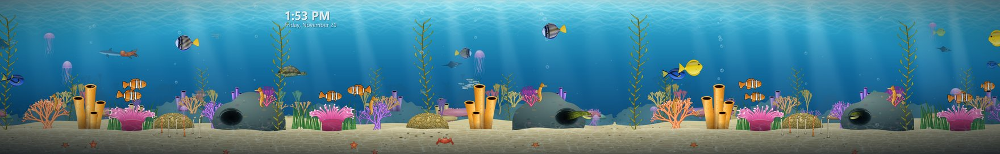

The first Windows release of Reefscape, the animated coral reef screensaver: fish, sharks, turtles, jellyfish, a moray eel, garden eels, Scuba Steve the diver and more, with day and night following your PC's clock.



## Which download?

| Download | What you get | Choose it if |
|---|---|---|
| **Reefscape-VCL-1.0.0-win64.zip** (4.6 MB) | `Reefscape.scr`, one self-contained file | You want a screensaver and nothing else. **Most people want this one.** |
| **Reefscape-FMX-1.0.0-win64.zip** (25.8 MB) | `ReefscapeFMX.scr`, `ReefscapeFMX.exe` and `sk4d.dll` (three files that must stay together) | You also want the reef as a program in a window, or prefer the Skia-drawn build. |

Both show the same reef and share the same settings. Both need 64-bit Windows 10 or 11. Each zip has a `README.txt` with the full instructions below.

## Install the VCL screensaver

1. Download **Reefscape-VCL-1.0.0-win64.zip**. Before unpacking, right-click the zip, choose **Properties**, tick **Unblock** at the bottom and click OK (this stops Windows blocking the file inside).
2. Unpack it and put `Reefscape.scr` somewhere it can stay, for example a folder `C:\Reefscape`. Windows remembers where the file is, so don't leave it in Downloads if you tidy that folder.
3. Right-click `Reefscape.scr` and choose **Install**. Screen Saver Settings opens with Reefscape selected.
4. Set **Wait** to the minutes of idle time you want and click **OK**.

To try it without installing, right-click the file and choose **Test**. Move the mouse or press a key to close it.

## Install the FMX version

1. Download **Reefscape-FMX-1.0.0-win64.zip** and unblock the zip as above.
2. Unpack all three files into one folder where they can stay, for example `C:\ReefscapeFMX`. **`sk4d.dll` must be in the same folder as the `.scr` and `.exe`**; neither starts without it.
3. As a screensaver: right-click `ReefscapeFMX.scr`, choose **Install**, set **Wait**, click **OK**.
4. As a program: double-click `ReefscapeFMX.exe`. **F** or **F11** = full screen, **S** or right-click = settings, **Esc** = leave full screen or close.

## "Windows protected your PC"

These files are not signed with a paid publisher certificate, so Windows SmartScreen may warn the first time you open one. Click **More info**, then **Run anyway**. You can check a download against `SHA256SUMS.txt`:

```
Get-FileHash .\Reefscape-VCL-1.0.0-win64.zip -Algorithm SHA256
```

## Settings

Right-click the `.scr` and choose **Configure**, or click **Settings...** in Screen Saver Settings.

- **Time of day:** follow the clock (default), always day, always sunset, always night, or a fast day/night cycle.
- **Clock:** off (default), time, date, or both. It changes corner every few minutes to avoid burn-in.
- **How many animals:** a few (default), some, or lots.
- **More than one screen:**
  - *One wide reef across all screens* (default): the reef stretches over every monitor and the animals swim from one to the next. Ultrawide monitors get a longer reef the same way.
  - *The same reef on every screen*
  - *A different reef on each screen*
  - *Main screen only*: the other screens go black.
  - Whichever you choose, the date and time show on the main screen only.
- **Animals and events:** tick or untick each of the 25 animals and events.

## Remove

1. In Screen Saver Settings pick another screensaver or **(None)** and click OK.
2. Delete the file(s).
3. Optional: the settings are in the registry under `HKEY_CURRENT_USER\Software\Reefscape`.

## Good to know

- The artwork is drawn for 1920 × 1080; on a 4K monitor it is enlarged and a little soft.
- With several monitors on an older graphics chip, *Main screen only* or *The same reef on every screen* is lighter than the default.
- The FMX version is built for Windows here. Its source also targets FireMonkey's other platforms, but those have not been built or tested.
- Installing through Screen Saver Settings and the small preview there follow the standard Windows screensaver switches (`/s`, `/c`, `/p`), which were tested directly; the Settings dialog itself was not driven during testing. Please open an issue if anything misbehaves.

## Command line

For testing, both take `/s` (full screen), `/w` (window), `/c` (settings) and options such as `hour=23`, `show=puffer`, `screens=each`. Windows always starts a `.scr` full screen, so use `ReefscapeFMX.exe`, or a copy of `Reefscape.scr` renamed to `.exe`. The READMEs list every option.

Source and build instructions: [`delphi/README.md`](https://github.com/jdredd87/reefscape/blob/main/delphi/README.md). The Roku version of Reefscape is in the Roku Streaming Store.
